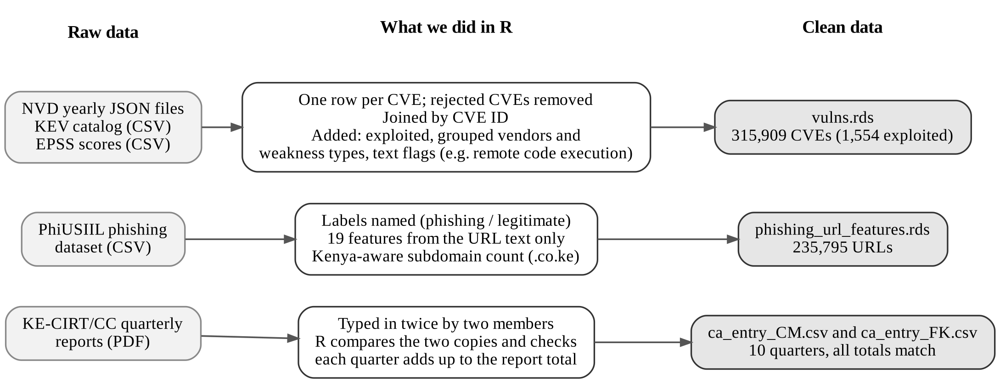
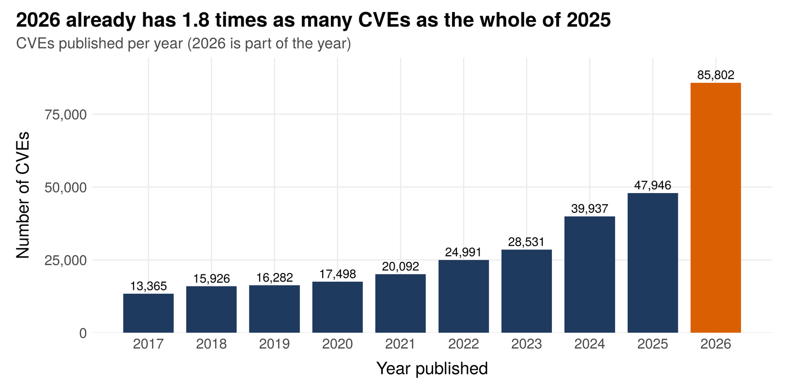
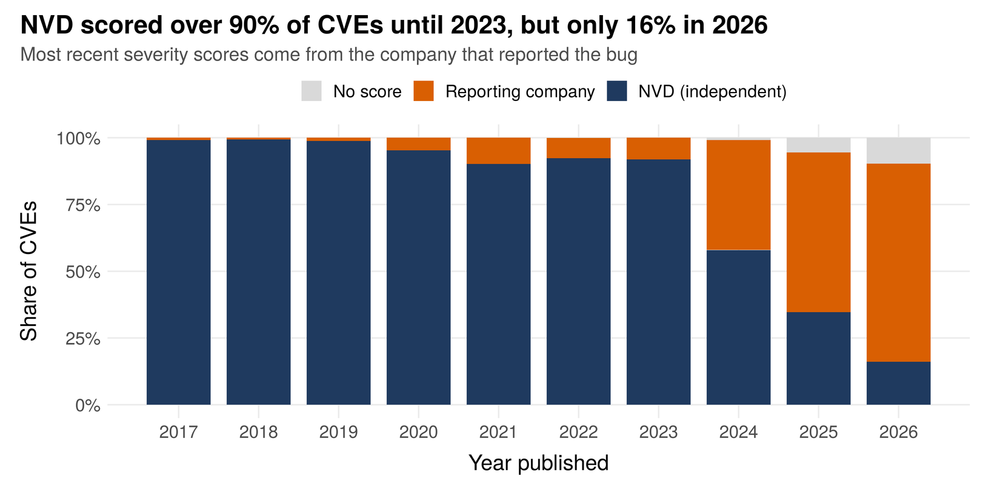
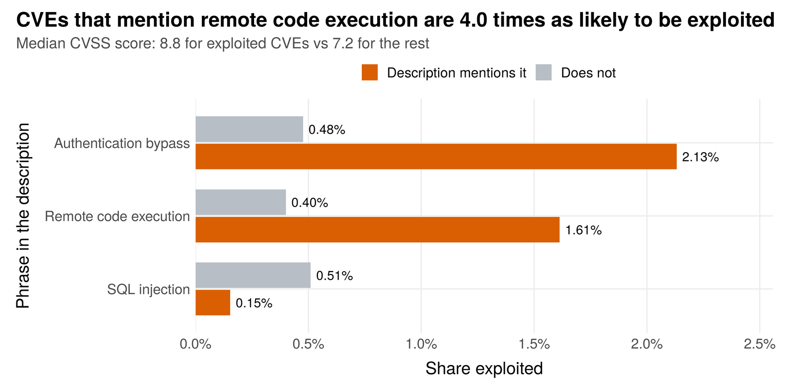
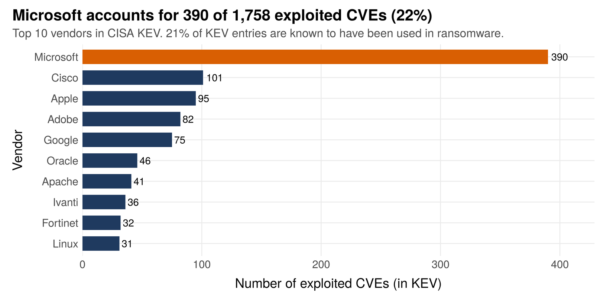
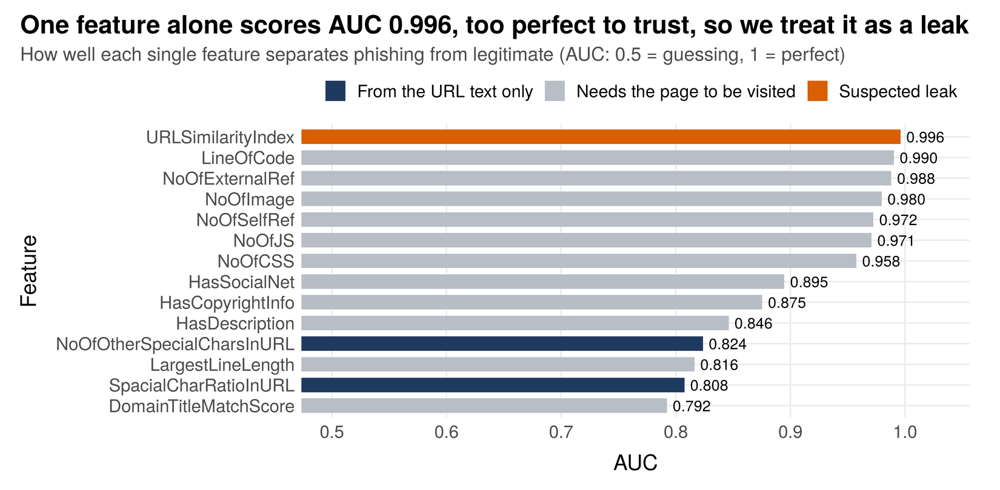
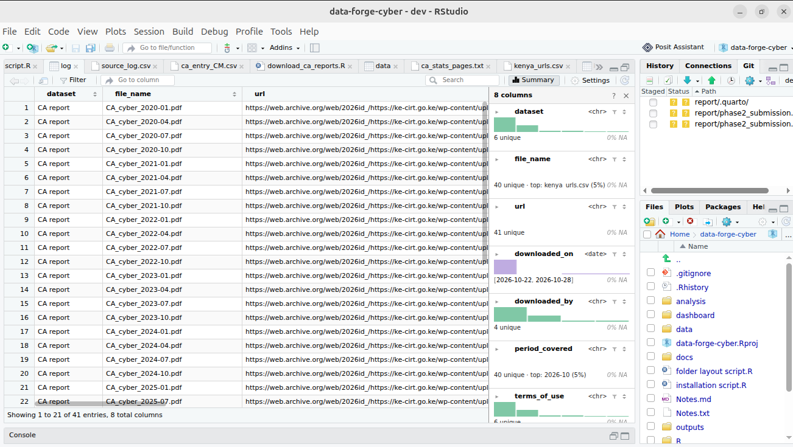
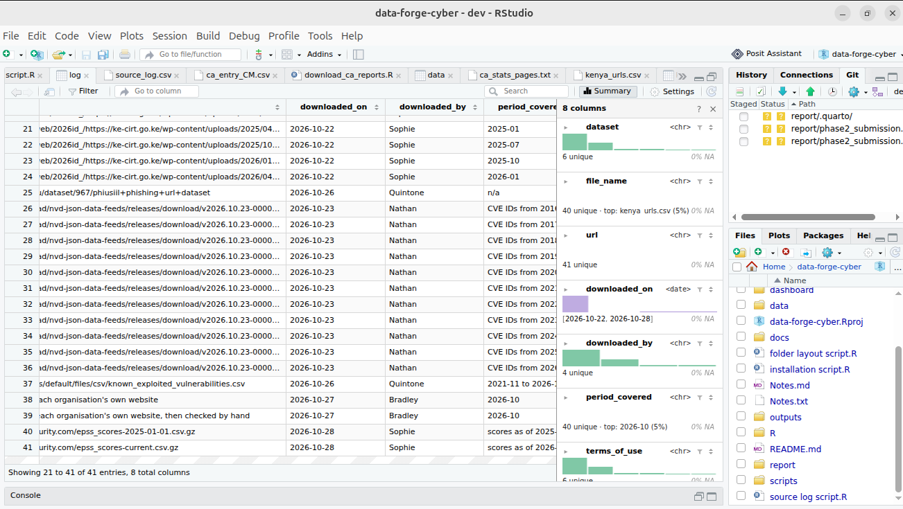
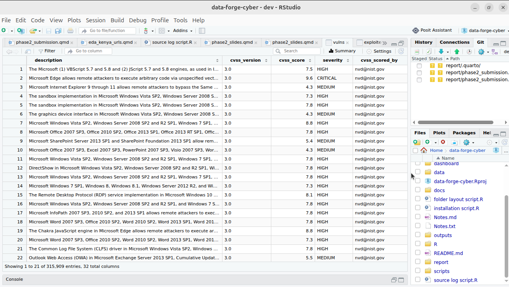
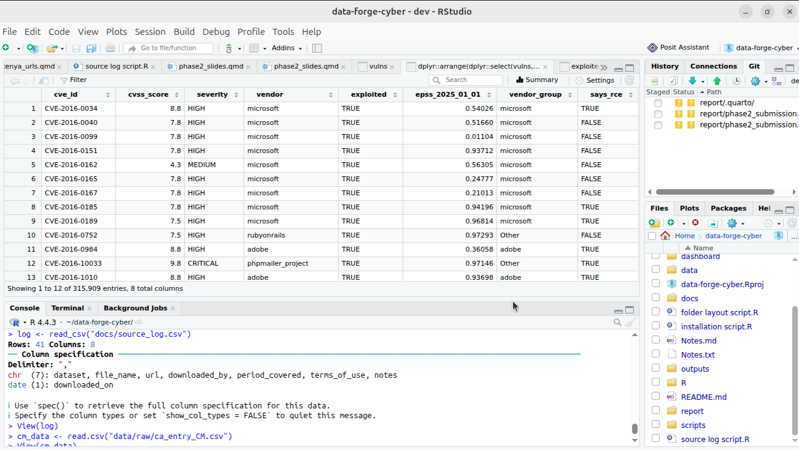

```{r}
#| label: setup
# HOW THIS REPORT WORKS
# - Render it with:  quarto render report/report.qmd
# - Charts come from outputs/figures/ (made by the analysis notebooks, copied
#   into report/figures/ below) and report/images/ (charts from our Phase 2 submission).
# - The Kenya numbers below are worked out here, in R, from our cleaned data.
# - Nathan's Part 2 section is pulled in from report/part2_results.qmd.
library(tidyverse)

# The PDF engine (Typst) can only read files inside the report/ folder,
# so copy the latest charts from outputs/figures/ into report/figures/ first.
dir.create("figures", showWarnings = FALSE)
invisible(file.copy(list.files(here::here("outputs", "figures"), full.names = TRUE), "figures", overwrite = TRUE))

# Kenya: one row per quarter with the total number of detected threat events
ke <- read_csv(here::here("data", "processed", "ca_totals.csv"), show_col_types = FALSE) |>
  arrange(period_start)

# Small helpers that turn numbers into readable text
millions <- function(x) paste0(round(x / 1e6, 1), " million")
billions <- function(x) paste0(round(x / 1e9, 1), " billion")
big      <- function(x) ifelse(x >= 1e9, billions(x), millions(x))
pct      <- function(x, d = 0) paste0(round(100 * x, d), "%")

first_q <- ke$reported_total[1]
last_q  <- ke$reported_total[nrow(ke)]
peak_q  <- max(ke$reported_total)
fold    <- round(last_q / first_q)

# Average growth per quarter: a straight line through the log of the totals
ke$t   <- seq_len(nrow(ke)) - 1
trend  <- lm(log(reported_total) ~ t, data = ke)
growth <- exp(coef(trend)["t"]) - 1
growth_range <- exp(confint(trend)["t", ]) - 1
yearly_growth <- (1 + growth)^4 - 1

# Year over year: add up the four quarters of each full calendar year
by_year <- ke |>
  mutate(year = lubridate::year(period_start)) |>
  group_by(year) |>
  summarise(quarters = n(), events = sum(reported_total)) |>
  filter(quarters == 4) |>
  mutate(change = events / lag(events) - 1)

# Share of detected events that are system attacks, first and last quarter
cats <- read_csv(here::here("data", "processed", "ca_quarterly.csv"), show_col_types = FALSE)
sys_share <- cats |>
  group_by(period_start) |>
  summarise(share = sum(events[category_std == "System attacks"]) / sum(events)) |>
  arrange(period_start)
```



# Summary

Kenya's national cyber security team detects billions of cyber threat events every quarter, and tens of thousands of new software weaknesses are published around the world every year. This report brings together the three phases of our project: the problem and research questions (Phase 1), the data and a first look at it (Phase 2), and the answers, models, conclusions and recommendations (Phase 3).

What we found, in short:

- **Threats detected in Kenya grew about `r fold` times** in six years, from `r big(first_q)` events in January to March 2020 to `r big(last_q)` in April to June 2026. Almost all of the growth came from one type, system attacks.
- **Very few weaknesses are ever used by attackers.** Only about 1 in 200 published vulnerabilities is known to be exploited, and no single feature predicts it well on its own.
- **Kenya's numbers do not follow global trends** from one quarter to the next, even though both rise over time.
- **Our model picks what to fix first better than the usual severity score.** Fixing the top 10% of its list would have caught 37% of the weaknesses attackers used later, against 22% for the severity score.
- **A phishing detector trained on global data fails on Kenyan websites.** It wrongly flags 56% of real Kenyan web addresses, including 78% of login and service pages.

All our code and data are on GitHub: <https://github.com/Sophie-Muchiri12/data-forge-cyber>

# Introduction (Phase 1)

Banks, SACCOs, universities, businesses, government offices and ordinary people in Kenya now depend on the internet, mobile money and digital systems. As more of life moves online, cyber threats such as malware, phishing, password-guessing (brute-force) attacks and attacks on software weaknesses keep changing.

The National Kenya Computer Incident Response Team Coordination Centre (National KE-CIRT/CC), part of the Communications Authority of Kenya, watches for these threats and publishes a report every quarter. Our project uses these reports, together with global data on software weaknesses and phishing, to understand Kenya's cyber threat landscape with data.

## The problem

- The Kenyan figures come out one quarter at a time, in separate PDF files, so it is hard to see the bigger picture over several years.
- Thousands of software weaknesses are published every year, but organisations cannot fix them all at once and need to know which ones matter most.
- It is not clear whether Kenya's threats follow global trends, or whether tools built on global data work for Kenya.

## Our research questions

a. **Trends:** How have the types of cyber threats detected in Kenya changed from quarter to quarter and year to year?
b. **What gets exploited:** Which features of a software weakness (its severity score, type and product) go with it being used in real attacks?
c. **Kenya and the world:** Do Kenya's threat numbers move with the number of weaknesses published and exploited worldwide?
d. **Prediction:** Can simple models use weakness features and web address features to spot high-risk threats?

## Why this matters

Kenya's digital economy is growing fast, and so is the number of ways it can be attacked. Turning separate quarterly reports into one dataset shows the trend. Knowing which weaknesses attackers actually use helps organisations fix the right things first. Testing global tools on Kenyan data shows whether they can be trusted here.

## How we worked

We followed the data science life cycle, one step per phase:

- **Understand the problem** (Phase 1): define the problem and the research questions.
- **Collect and clean the data** (Phase 2): download the data with R scripts and clean it in code.
- **Explore the data** (Phase 2): charts and summaries to understand each dataset.
- **Model and test** (Phase 3): statistics and two prediction models, each tested on data it had never seen.
- **Communicate** (Phase 3): this report and our presentation.

# Data (Phase 2)

## Where the data came from

We used six public data sources. The last one we built ourselves.

- **KE-CIRT/CC quarterly reports** (Communications Authority of Kenya): threat events detected in Kenya each quarter, by type. `r nrow(ke)` reports, January 2020 to June 2026.
- **National Vulnerability Database (NVD)**, from NIST: every published software weakness (called a CVE) with a severity score from 0 to 10 (the CVSS score). 315,909 CVEs from 2016 to 2026.
- **Known Exploited Vulnerabilities (KEV) catalog**, from CISA: the CVEs with proof of being used in real attacks. 1,758 CVEs. We use it to decide whether a CVE was "exploited".
- **Exploit Prediction Scoring System (EPSS)**, from FIRST: the industry's own estimate of how likely each CVE is to be exploited. We use the scores published on 1 January 2025 as a fair benchmark.
- **PhiUSIIL phishing dataset** (Prasad and Chandra): 235,795 web addresses labelled phishing or legitimate.
- **Kenyan web address list** (our team): 308 real, legitimate Kenyan web addresses from 119 organisations, each marked as a homepage, a login or service page, or a deeper page.

## How we collected it

We kept three rules. Every download is done by an R script, so it can be repeated. Every download is written in a source log with its link, date, who downloaded it and the terms of use (see the Appendix). Original files are never edited; all changes happen in code. Older Kenyan reports that had been taken off the website were recovered from the Internet Archive.

## How we cleaned it

{#fig-flow}

- **Kenya:** the figures were taken from the PDFs by script, checked against each report's total, and given one consistent set of category names, because the names changed in July 2023. All `r nrow(ke)` quarters have a total, and `r n_distinct(cats$period_start)` also have a breakdown by type.
- **Vulnerabilities:** CVEs without a severity score were kept but marked as missing, and we removed columns that are only filled in after a CVE is exploited, so our models cannot "see the answer".
- **Phishing:** we wrote our own R function that works out 18 features from the web address text alone, so the same features can be computed for the Kenyan list.

## Ethics

- We used only public data, followed each source's licence, and credit every source.
- We collected no personal information and visited no phishing websites.
- We do not claim that any weakness caused a specific attack in Kenya; our data cannot show that.
- We state the limits of our data and do not present findings as more certain than they are.

# A first look at the data (Phase 2)

These charts from our Phase 2 exploration shaped the questions we asked in Phase 3.

{#fig-cves-year}

New weaknesses rise every year (@fig-cves-year). No organisation can fix this many, so choosing what to fix first matters.

{#fig-who-scores}

Until 2023 the independent NVD scored over 90% of CVEs. By 2026 most scores come from the company that reported the bug (@fig-who-scores), so severity scores from different years are not fully comparable.

{#fig-phrases}

CVEs whose description mentions "remote code execution" or "authentication bypass" are exploited several times as often as the rest (@fig-phrases), so we used these phrases in our model.

{#fig-vendors}

Microsoft has the most exploited CVEs, followed by Cisco, Apple, Adobe and Google (@fig-vendors), so the vendor is likely to matter.

{#fig-auc}

One phishing feature, URLSimilarityIndex, is almost perfect on its own (@fig-auc). That is too good to be true, so we treat it as a "leak" and leave it out.

# Results (Phase 3)

## Part 1: How have threats in Kenya changed? {#sec-part1}

*This answers research question (a).*

{#fig-p1-totals}

Detected threat events rose from `r big(first_q)` in January to March 2020 to `r big(last_q)` in April to June 2026, about `r fold` times higher, with a peak of `r big(peak_q)` (@fig-p1-totals). On average they grew by `r pct(growth)` a quarter (somewhere between `r pct(growth_range[1])` and `r pct(growth_range[2])`), which is about `r pct(yearly_growth)` a year. The path is very bumpy, though: some quarters fell sharply and others jumped.

Year over year, every full year was more than double the one before:

```{r}
#| label: tbl-years
#| tbl-cap: "Threat events detected in Kenya per calendar year."
by_year |>
  transmute(Year = year,
            `Detected events` = big(events),
            `Change from the year before` = ifelse(is.na(change), "", paste0("+", pct(change)))) |>
  knitr::kable()
```

{#fig-p1-shares}

System attacks drove the growth. They were `r pct(first(sys_share$share), 1)` of detected events in early 2020 and `r pct(last(sys_share$share))` by mid-2026 (@fig-p1-shares).

{#fig-p1-other}

With system attacks taken out, malware's share of the rest fell from 97% to 58%, while brute-force and web application attacks grew (@fig-p1-other).

**Answer to (a).** Threats detected in Kenya rose steeply, both quarter over quarter and year over year, and changed from mostly malware to mostly system attacks. Part of this growth is better detection, not only more attacks: the Communications Authority says improved monitoring explains part of its biggest jump, in October to December 2023.



**Answer to (b).** Exploited weaknesses tend to be Critical, to let an attacker run code remotely or skip the login, and to affect widely used products such as Microsoft's and Cisco's. But each of these links is weak on its own, so a good prediction has to combine many features. That is what our model in Part 3 does.

## Kenya and the world: do the trends match? {#sec-kenya-global}

*This answers research question (c).*

{#fig-p9}

Both lines go up (@fig-p9), but that alone does not mean they are linked: two things that both grow over time will always look related. So we checked two things (Spearman correlation, where 1 means a perfect match and 0 means no link):

- **Overall levels move together** (0.92): busy quarters in Kenya are also quarters with many new CVEs worldwide.
- **Quarter-to-quarter changes do not** (−0.01): when one jumps, the other does not follow.
- **Kenya grew much faster:** about 68 times, against about 5 times for new CVEs worldwide.
- **No link with real attacks worldwide:** the number of CVEs added to the KEV catalog each quarter has no link with Kenya's numbers (−0.05).

**Answer to (c).** Kenya's numbers and global weaknesses share an upward trend, but they do not move together from quarter to quarter. Kenya's much faster growth fits the Authority's explanation that better detection is part of the story.

## Part 3: Which weaknesses should be fixed first? {#sec-part3}

*This answers the first half of research question (d).*

**The fair test.** We pretended it was 1 January 2025 and used only what was known that day. The model learned from CVEs published from 2016 to 2021. We then asked it to rank 92,724 CVEs published from 2022 to 2024. Of these, 59 were added to the KEV catalog after 1 January 2025; a good ranking should put those 59 near the top.

**The model.** We tried a simple logistic regression and a random forest, using each CVE's severity score and its parts, weakness type, vendor, key phrases in the description and description length. The random forest did better on the training data, so we used it.

{#fig-p3}

```{r}
#| label: tbl-p3
#| tbl-cap: "Share of the 59 later-exploited CVEs caught at different amounts of fixing."
# Numbers from analysis/part3_prioritisation.qmd
tribble(
  ~`Share of CVEs fixed`, ~`Severity score (CVSS)`, ~EPSS, ~`Our model`,
  "Top 1%",  "3%",  "10%", "7%",
  "Top 5%",  "17%", "20%", "27%",
  "Top 10%", "22%", "22%", "37%",
  "Top 20%", "41%", "36%", "56%"
) |> knitr::kable()
```

Fixing the top 10% of our model's list would have caught 37% of the CVEs attackers used later, against 22% for both the severity score and EPSS (@fig-p3). We checked this with 1,000 random re-samples: our model is clearly better than the severity score, and about as good as EPSS. That is a good result, because EPSS uses much richer data (such as published attack code), while our model only uses what the NVD publishes.

The usual rule, "fix everything rated High or Critical", catches 90% of the later-exploited CVEs, but only by fixing more than half of all CVEs (53%). Only about 1 in 1,000 of the fixes turns out to matter.

{#fig-p3-features}

The model leans most on description length, whether the vendor is Microsoft, the severity score, a mention of remote code execution, and command-injection weaknesses (@fig-p3-features).

## Part 4: Can a phishing link be spotted from the address alone? {#sec-part4}

*This answers the second half of research question (d).*

A browser warning or SMS filter has to judge a link before anyone opens it, so our phishing model looks only at the web address. We trained a simple logistic regression on 80% of the global PhiUSIIL dataset and tested it on the other 20%.

**A trap we found: the trailing slash.** No legitimate address in PhiUSIIL ends in "/", but about a third of phishing addresses do, and almost every Kenyan homepage is stored with one (for example `https://www.kcbgroup.com/`). The slash changes nothing about the website, so we removed it from every address before training and testing.

```{r}
#| label: tbl-p4
#| tbl-cap: "The phishing model on the global test set (47,159 addresses). False alarms: legitimate addresses wrongly flagged."
# Numbers from analysis/part4_phishing.qmd
tribble(
  ~Model, ~Accuracy, ~`Phishing caught`, ~`False alarms`,
  "All features (has the leak)", "100.0%", "100.0%", "0.0%",
  "Address only, slash kept",    "99.0%",  "98.7%",  "0.7%",
  "Address only (our model)",    "94.3%",  "91.5%",  "3.6%"
) |> knitr::kable()
```

The model still looks good on global data (94% accurate). Then we tested it on our 308 real Kenyan web addresses. All of them are legitimate, so every one it flags is a false alarm.

{#fig-p4}

The model wrongly flags **56% of real Kenyan addresses**, against 3.6% of global ones (@fig-p4). Homepages are mostly fine (3%), but 78% of login and service pages and 94% of deeper pages are flagged, which is exactly where people type passwords and M-Pesa details.

**Why?** In PhiUSIIL, not one legitimate address has anything after the domain name (such as `/login`). So the model learned a shortcut: "anything after the domain means phishing". Kenyan login pages break that rule, so they get flagged.

**Answer to (d).** Yes, within limits. Our weakness model ranked the dangerous CVEs better than the severity score, using only public data. The phishing model looked excellent on global data but learned shortcuts from that data and failed on real Kenyan websites, so it should not be used in Kenya without retraining on Kenyan pages.

# What the data tells us

1. **Detected is not the same as attacked.** Kenya's numbers grew much faster than global weaknesses, and the biggest jump came with better monitoring. The figures show how much is detected, not only how much is attempted.
2. **System attacks are the main threat in Kenya,** at 96% of detected events.
3. **Severe does not mean dangerous.** About 99 in 100 Critical weaknesses are never seen in a known attack. Who makes the product and what the bug allows matter as much as the score.
4. **A high score can hide a shortcut.** A leaked feature and a trailing slash both made phishing models look better than they are.
5. **Global tools need local testing.** A model that is 94% accurate on global data raised false alarms on most Kenyan login pages.

# Conclusions

Using only public data, we turned separate quarterly reports into a six-year picture of cyber threats in Kenya and compared it with global data. Threats detected in Kenya have grown steeply and are now mostly system attacks, though part of the growth is better detection. Attackers use very few published weaknesses, and no single feature tells you which. Combining features, our model chose what to fix first better than the usual severity score. Kenya's numbers rise like the global ones but do not move with them. Finally, a phishing model trained on global data failed on Kenyan websites. Data science can help Kenyan defenders use their time better, as long as models are tested on Kenyan data.

# Recommendations

1. **Kenyan organisations (banks, SACCOs, counties, universities) should fix weaknesses by how likely they are to be used, not by severity alone.** Start with everything in the KEV catalog, then work down a ranked list such as EPSS or a model like ours. In our test this caught 37% of later attacks for 10% of the work, against 22% for the severity score.
2. **Protect internet-facing systems first.** System attacks are 96% of detected events, and Microsoft and Cisco products have some of the highest odds of being exploited.
3. **The Communications Authority should publish its quarterly figures as open data** (for example CSV files), keep category names stable, and say when detection methods change. We had to pull every number out of PDFs.
4. **Phishing filters used in Kenya should be trained and tested on Kenyan websites,** including login, M-Pesa and e-government pages. Banks and government bodies should publish official lists of their login addresses.
5. **Anyone building models should check for leaks and shortcuts before trusting a high score.** Looking at which feature the model relies on, and how each group's data is stored, uncovered both of our phishing problems.

# Limitations and future work

- Kenya's figures are detected events (mostly blocked attempts), not confirmed attacks, and detection methods changed over time.
- Five quarters have totals but no breakdown by type, and some matches between renamed categories are our judgement.
- The KEV catalog focuses on products used by the United States government, so some exploited weaknesses are missing from it.
- Only 59 test CVEs were exploited after 1 January 2025, so the Part 3 results have wide uncertainty.
- Our Kenyan list has only legitimate websites, so we could measure false alarms but not how well the model catches phishing aimed at Kenyans.

In future, we would like to collect real phishing links aimed at Kenyans to build a Kenyan phishing detector, and to re-test our weakness model as more attacks are recorded.

# References

Cybersecurity and Infrastructure Security Agency. (2026). *Known exploited vulnerabilities catalog* \[Data set\]. <https://www.cisa.gov/known-exploited-vulnerabilities-catalog>

Data Forge. (2026). *data-forge-cyber* \[Source code and data set\]. GitHub. <https://github.com/Sophie-Muchiri12/data-forge-cyber>

fkie-cad. (2026). *NVD JSON data feeds* \[Data set\]. GitHub. <https://github.com/fkie-cad/nvd-json-data-feeds>

Forum of Incident Response and Security Teams. (2025). *Exploit Prediction Scoring System (EPSS) scores, January 1, 2025* \[Data set\]. <https://www.first.org/epss/data_stats>

National Institute of Standards and Technology. (2026). *National vulnerability database* \[Data set\]. <https://nvd.nist.gov/>

National KE-CIRT/CC. (n.d.). *Quarterly cyber security reports*. Communications Authority of Kenya. <https://ke-cirt.go.ke/quarterly-reports/>

Prasad, A., & Chandra, S. (2024). PhiUSIIL: A diverse security profile empowered phishing URL detection framework based on similarity index and incremental learning. *Computers & Security, 136*, 103545. <https://doi.org/10.1016/j.cose.2023.103545>

R Core Team. (2024). *R: A language and environment for statistical computing* \[Computer software\]. <https://www.R-project.org/>

Wright, M. N., & Ziegler, A. (2017). ranger: A fast implementation of random forests for high dimensional data in C++ and R. *Journal of Statistical Software, 77*(1), 1–17. <https://doi.org/10.18637/jss.v077.i01>



# Appendix: data collection screenshots {.appendix}

{#fig-log1}

{#fig-log2}

{#fig-nvd}

{#fig-cols}
